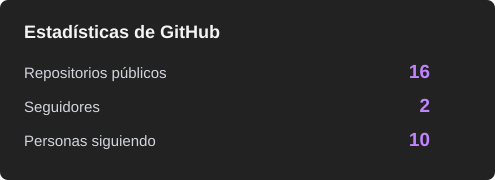
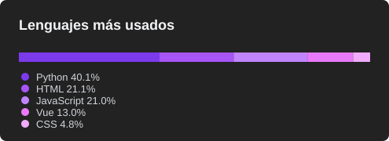

  <!-- Badges de Estado y Enlaces Rápidos -->
  
  &nbsp;
  
  &nbsp;
  

    

  <!-- Presentación Animada Responsiva -->
  

    
  

    

  <!-- Saludo Principal -->
  <h1>Hey , ¡Soy Alan!</h1>

  <!-- Texto Animado Dinámico (Typing SVG) -->
  

    
  

  <!-- Chips de Información -->
  

    
    
    
    
  

  

### 👨‍💻 Sobre mí

> **Especializado en el desarrollo de sistemas de gestión empresarial (PyMEs)** e involucrado activamente en la administración, pruebas y soporte técnico de herramientas para comunidades de gaming (*MiaBot*, *Glow Launcher*, *Py-Clash-Bot*). Apasionado por la automatización de procesos, el desarrollo robusto y el trabajo colaborativo.

- 🎓 **Formación:** Estudiante de Ingeniería en Sistemas Informáticos.
- 💻 **Perfil:** Full-Stack Developer (`Java`, `PHP`, `SQL`) & Community Administrator / Beta Tester.
- 🌍 **Modalidad & Ubicación:** Paraguay (UTC-4) · Disponible para proyectos remotos.
- 🌐 **Portafolio en Vivo:** [alandce.github.io/Portafolio](https://alandce.github.io/Portafolio/)
- 📫 **Contacto directo:** [escurraalandaniel@gmail.com](mailto:escurraalandaniel@gmail.com?subject=Contacto%20desde%20GitHub)

---

### 🚀 Proyectos Destacados

<table>
  <tr>
    <td width="50%" valign="top">
      <h4 align="center">🎮 Ecosistema Mia (Admin & Beta Tester)</h4>
      

        
        
        
      

      
Administrador y Beta Tester de una suite avanzada de herramientas para la comunidad de Fortnite (STW y BR):

      <ul>
        <li><b>Mia Checker:</b> Pruebas de funcionamiento, aseguramiento de calidad y asistencia a usuarios en la herramienta de verificación de cuentas.</li>
        <li><b>Mia Launcher & Bot:</b> Testeo de nuevas versiones (como la v0.1.6 con AutoKick) y moderación de la comunidad.</li>
      </ul>
    </td>
    <td width="50%" valign="top">
      <h4 align="center">💼 Sistemas de Gestión PyMEs (Freelance)</h4>
      

        
        
      

      
Diseño y desarrollo de software a medida para pequeñas y medianas empresas:

      <ul>
        <li>Automatización de procesos de facturación electrónica y tradicional.</li>
        <li>Control integral de cobros, cuentas corrientes y flujo de caja.</li>
        <li>Gestión de inventario y stock con punto de venta (POS).</li>
      </ul>
    </td>
  </tr>
</table>

---

### 🤝 Comunidades y Contribuciones Open Source

| Proyecto | Rol | Descripción | Enlaces |
| :--- | :---: | :--- | :---: |
| **Glow Launcher** | `🛡️ Moderador` | Moderador activo brindando soporte a usuarios y manteniendo el orden en la comunidad oficial. | [Discord](https://discord.gg/unGx7Nh46d) • [GitHub](https://github.com/STWJXSX/Glow-Launcher) |
| **Py-Clash-Bot** | `💻 Colaborador` | Colaborador en proyecto Open Source de un bot de Clash Royale automatizado en Python. | [GitHub](https://github.com/pyclashbot/py-clash-bot) |
| **Lynx Bot** | `🤝 Helper` | Helper oficial orientando a nuevos usuarios y asistiendo en dudas frecuentes. | [Discord](https://discord.gg/mM4qs49Vka) |

---

### 🛠️ Stack Tecnológico y Herramientas

  

  

### 📊 Estadísticas de GitHub

  
  &nbsp;&nbsp;
  

---

### 🐍 Actividad de Contribuciones

  

  

### 🌐 Conecta conmigo

  
  &nbsp;
  
  &nbsp;
  
  &nbsp;
  

  🎮 Apoya usando el código de creador: <code>NotMia</code> / <code>NotAlan</code>

